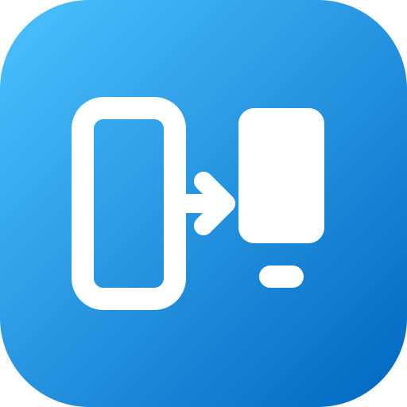
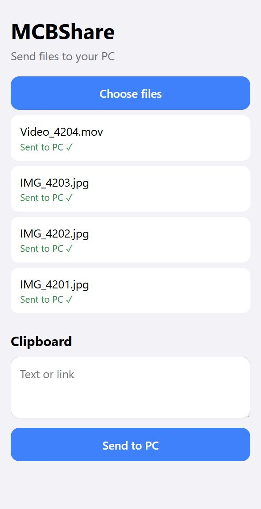
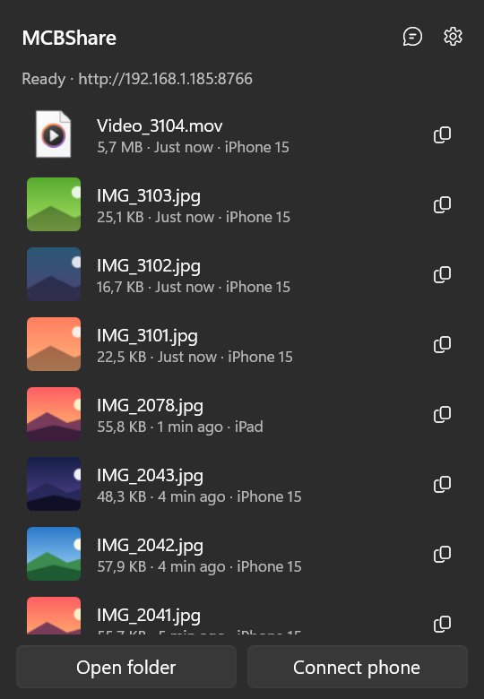
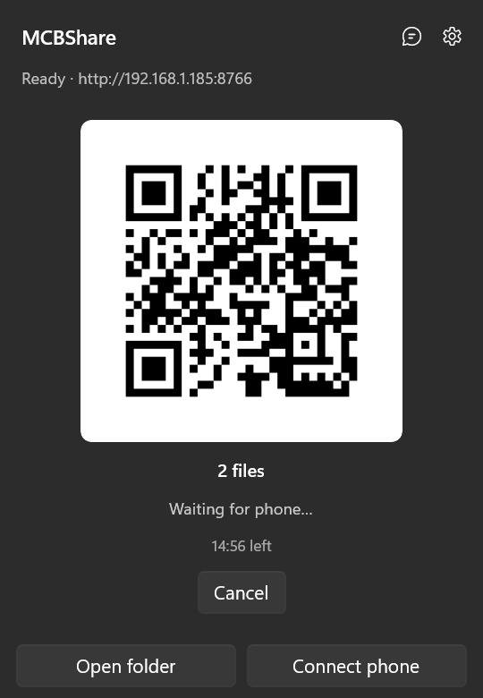

<div align="center">



# MCBShare

**Send files and text between your phone and your Windows PC over the same Wi-Fi. No cable, no cloud.**

[](https://github.com/MehmetCanBeyaztas/MCBShare/releases/latest)
[](https://github.com/MehmetCanBeyaztas/MCBShare/releases)
[](https://github.com/MehmetCanBeyaztas/MCBShare/actions/workflows/ci.yml)


[**⬇ Download MCBShare**](https://github.com/MehmetCanBeyaztas/MCBShare/releases/latest/download/MCBShareApp-win-Setup.exe) · [All releases](https://github.com/MehmetCanBeyaztas/MCBShare/releases) · [Türkçe](README.md)

</div>

There's nothing to install on the phone. MCBShare runs a small server on your local network; the phone connects from its browser or from an iOS Shortcut. Files never leave your network: no account, no upload to a cloud, they go straight to your PC.

<table>
  <tr>
    <td align="center" width="33%"><br><sub><b>Phone:</b> choose files, send</sub></td>
    <td align="center" width="33%"><br><sub><b>PC:</b> received files, open or copy in one click</sub></td>
    <td align="center" width="33%"><br><sub><b>PC to phone:</b> drag, scan the QR</sub></td>
  </tr>
</table>

<p align="center"><br><sub>The transfer box that opens at the bottom of the screen when a file arrives</sub></p>

---

## Features

### 📱 → 💻 Phone to PC
- **From the browser:** Open the MCBShare page on your phone, pick files, send. Works on iPhone and Android.
- **From the Share menu (iPhone):** With the ready-made iOS Shortcut, tap Share in Photos or Files and pick MCBShare.
- **Large files and dropped connections:** Files are sent in chunks. If the connection drops, the transfer resumes where it stopped.
- **Batches:** Pick many files at once. The transfer box on the PC shows progress as "Receiving 3/10".
- **No duplicates:** If a file with the same content arrives again, no new copy is made.
- **HEIC to JPG:** iPhone photos can be converted to JPG automatically.
- **Folders by date:** Received files can be sorted into subfolders by the date they were taken, using EXIF data when present.

### 💻 → 📱 PC to phone
- **Drag, drop, scan:** Drag files onto the MCBShare panel, then scan the QR code with the phone camera to download them.
- **Short-lived shares:** A share link is valid for 15 minutes. Once the download finishes, it closes on its own within a minute.

### 📋 Text and clipboard
- **Text from phone to PC:** Text or a link typed on the phone goes straight to the PC clipboard.
- **Text from PC to phone:** Choose which phone gets the text. It only shows up on that phone.
- **Text as a QR code:** Puts the text inside the QR code itself, so no network is needed.

### 🪟 Made for Windows
- **Lives quietly in the tray:** Click the icon to see the latest received files.
- **Transfer box:** A small box opens at the bottom of the main screen while a file arrives, with a preview, progress and a **Copy** button. Clicking the box opens the file.
- **Stays out of the way:** The transfer box doesn't appear during full-screen apps or presentations.
- **Starts with Windows** and **updates itself.** Updates install while you're not using the app.
- **Turkish and English** interface.

### 🔒 Security
- **Only on networks you trust:** The server stays off until you choose "Trust this network". On café or hotel Wi-Fi it stays off.
- **Local network only:** Requests from the internet are rejected.
- **Paired devices:** Each phone pairs once with a QR code and gets its own key. The PC only stores a hash of the key. Removing a device in Settings revokes its access immediately.
- **Rate limiting:** Clients with too many failed attempts are blocked for a while.

> Traffic on the local network is plain HTTP. Someone listening on the same network could see the files being transferred. Only use MCBShare on networks you trust, such as home or work.

---

## Installation

1. Download and run [MCBShareApp-win-Setup.exe](https://github.com/MehmetCanBeyaztas/MCBShare/releases/latest/download/MCBShareApp-win-Setup.exe).
   - The package isn't signed, so SmartScreen may warn you. Choose **More info → Run anyway**.
   - No administrator rights are needed. The app installs to `%LOCALAPPDATA%\MCBShareApp`.
2. If Windows Firewall asks, allow access on **Private networks**.

To try it without installing, use the portable `MCBShareApp-win-Portable.zip` from the [releases page](https://github.com/MehmetCanBeyaztas/MCBShare/releases).

## Usage

### First connection
1. Click the MCBShare icon on the right side of the taskbar.
2. In the panel, click **Trust this network**.
3. Click **Connect phone**. Scan the QR code with the phone camera and give the device a name.
4. Add the page to the phone's home screen so it opens with one tap next time.

### iPhone Share menu (optional)
1. On the PC, go to **Settings → iOS Shortcut setup → Open setup on iPhone**.
2. Scan the QR code with the iPhone.
3. Follow the 4 steps on the page: copy the address, add the shortcut, paste the key, try it.

From then on, pick MCBShare from the Share menu when sharing a photo or file.

### Settings
- **Save folder:** Where received files are saved.
- **Behavior:** Start with Windows, show the transfer box, HEIC → JPG, sort into folders by date, don't save the same file twice.
- **Cleanup:** After how many days the list and outbox are cleared.
- **Trusted networks and devices:** See and remove added networks and phones.
- **Language:** Turkish, English, or the Windows language.

### Troubleshooting
| Symptom | Fix |
| --- | --- |
| The phone says "Can't reach your PC" | Are the PC and the phone on the same Wi-Fi? Is the PC asleep? Does the panel say "Ready"? |
| The panel says "This network isn't approved" | Click **Trust this network**. |
| "The port is used by another app" | Close the app using port 8765. |
| A transfer stops halfway | The browser pauses transfers when the phone locks. Keep the page open; the transfer resumes where it stopped. |

For detailed logs, use **Settings → Open log folder**.

---

## Development

**Stack:** .NET 10, WinUI 3 (Windows App SDK), Kestrel, H.NotifyIcon, QRCoder, Velopack.

| Folder | Contents |
| --- | --- |
| `src/MCBShare.Core` | UI-independent server and logic. The phone pages live here too (`Web/`). |
| `src/MCBShare.App` | WinUI 3 app: tray, panel, transfer box, QR, settings. |
| `tests/MCBShare.Core.Tests` | Core tests (xunit). |
| `docs/PROTOCOL.md` | HTTP endpoints and error codes between the phone and the PC (in Turkish). |

You only need the .NET 10 SDK.

To run the tests:

```bash
dotnet test tests/MCBShare.Core.Tests
```

To start the app:

```bash
dotnet run --project src/MCBShare.App
```

Environment variables for Debug builds:

| Variable | Effect |
| --- | --- |
| `MCBSHARE_DATA` | Changes the settings and history folder. |
| `MCBSHARE_BIND` | Address the server listens on, e.g. `127.0.0.1`. |
| `MCBSHARE_DEV=1` | The panel stays open when it loses focus; the transfer box also appears over full-screen apps. Debug only. |

### Releasing

Pushing a `vX.Y.Z` tag makes `.github/workflows/release.yml` run the tests, build the app and upload the Velopack package to GitHub Releases.

First create the tag:

```bash
git tag v0.1.6
```

Then push it:

```bash
git push origin v0.1.6
```

Installed copies check for a new version 1 minute after starting and every 6 hours after that. A new version is downloaded and installed when the panel and settings are closed and no transfer is running. The app then restarts.

## Roadmap
- "Send with MCBShare" in the Windows 11 right-click menu. As groundwork, `MCBShare.exe --share <files>` is already forwarded to the running app.
- Microsoft Store (MSIX) version
- HTTP Shortcuts configuration file for Android
- mDNS, to find the PC by name instead of IP address
