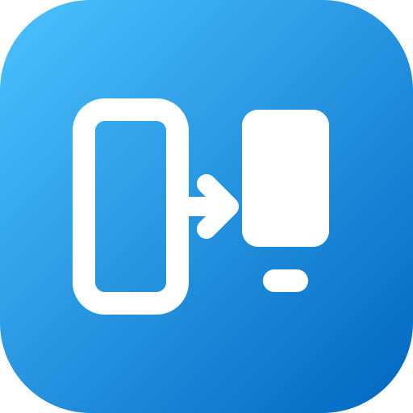
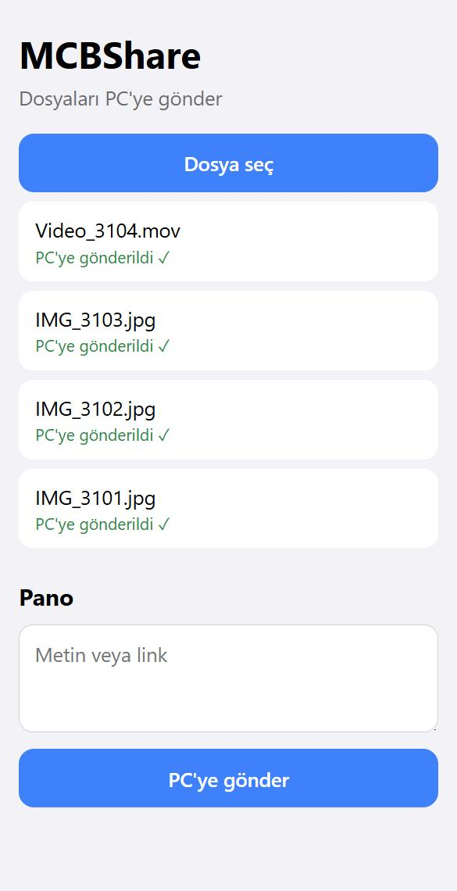
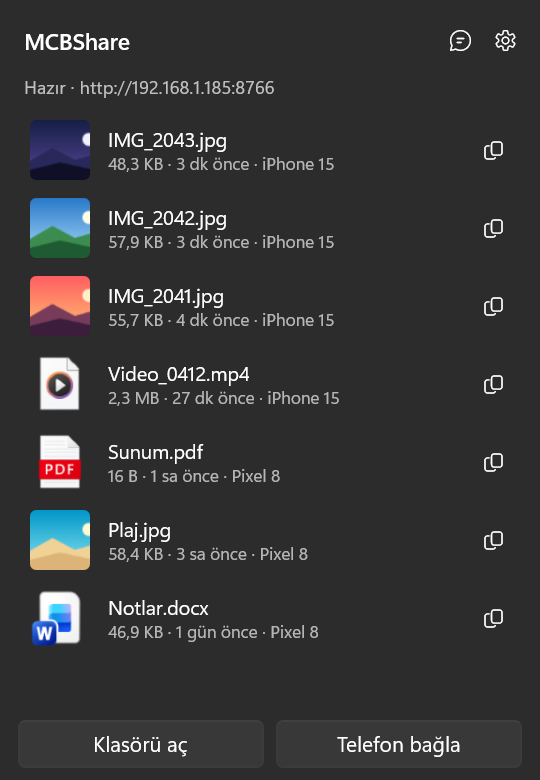
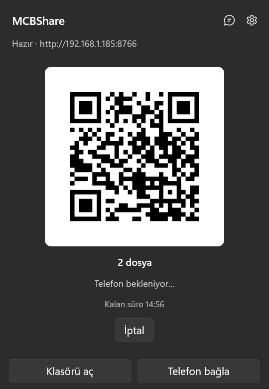
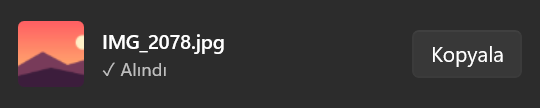

<div align="center">



# MCBShare

**Telefon ile Windows PC arasında, aynı Wi-Fi üzerinden, kablosuz ve bulutsuz dosya ve metin aktarımı.**

[](https://github.com/MehmetCanBeyaztas/MCBShare/releases/latest)
[](https://github.com/MehmetCanBeyaztas/MCBShare/releases)
[](https://github.com/MehmetCanBeyaztas/MCBShare/actions/workflows/ci.yml)


[](LICENSE)

[**⬇ MCBShare'i indir**](https://github.com/MehmetCanBeyaztas/MCBShare/releases/latest/download/MCBShareApp-win-Setup.exe) · [Tüm sürümler](https://github.com/MehmetCanBeyaztas/MCBShare/releases) · [English](README.en.md)

</div>

Telefona uygulama kurmanız gerekmez. PC'deki MCBShare, yerel ağda küçük bir sunucu açar; telefon tarayıcıdan veya iOS Kısayolu'ndan bağlanır. Dosyalar internete çıkmaz, bir hesaba ya da buluta yüklenmez, doğrudan PC'nize yazılır.

<table>
  <tr>
    <td align="center" width="33%"><br><sub><b>Telefon:</b> dosya seç, gönder</sub></td>
    <td align="center" width="33%"><br><sub><b>PC:</b> gelen dosyalar, tek tıkla aç veya kopyala</sub></td>
    <td align="center" width="33%"><br><sub><b>PC'den telefona:</b> sürükle, QR'ı okut</sub></td>
  </tr>
</table>

<p align="center"><br><sub>Dosya gelince ekranın altında açılan aktarım kutusu</sub></p>

---

## Özellikler

### 📱 → 💻 Telefondan PC'ye
- **Tarayıcıdan gönderim:** Telefonda MCBShare sayfasını açın, dosyaları seçin, gönderin. iPhone ve Android'de çalışır.
- **Paylaş menüsünden gönderim (iPhone):** Hazır iOS Kısayolu ile Fotoğraflar'da veya Dosyalar'da "Paylaş"a dokunup MCBShare'i seçmeniz yeter.
- **Büyük dosyalar ve kopan bağlantılar:** Dosyalar parça parça gönderilir. Bağlantı koparsa aktarım kaldığı yerden devam eder.
- **Toplu gönderim:** Birden çok dosyayı tek seferde seçebilirsiniz. PC'deki aktarım kutusu ilerlemeyi "3/10 alınıyor" şeklinde gösterir.
- **Aynı dosyayı iki kez kaydetmez:** İçeriği aynı olan dosya yeniden gelirse yeni kopya oluşturulmaz.
- **HEIC'ten JPG'ye:** iPhone fotoğrafları istenirse otomatik olarak JPG'ye dönüştürülür.
- **Tarihe göre klasörleme:** Gelen dosyalar çekim tarihine göre alt klasörlere ayrılabilir. EXIF bilgisi varsa o kullanılır.

### 💻 → 📱 PC'den telefona
- **Sürükle, bırak, okut:** Dosyaları MCBShare paneline sürükleyin. Çıkan QR kodunu telefon kamerasıyla okutup indirin.
- **Kısa ömürlü paylaşımlar:** Paylaşım bağlantısı 15 dakika geçerlidir. İndirme bitince 1 dakika içinde kendiliğinden kapanır.

### 📋 Metin ve pano
- **Telefondan PC'ye metin:** Telefonda yazdığınız metin veya link, PC'nin panosuna doğrudan kopyalanır.
- **PC'den telefona metin:** Metni hangi telefona göndereceğinizi seçersiniz. Metin yalnızca o telefonda görünür.
- **QR ile metin:** Ağ gerektirmeden, metni doğrudan QR kodunun içine koyarak gösterir.

### 🪟 Windows ile uyumlu
- **Tepside sessizce çalışır:** Simgeye tıklayınca son gelen dosyaların listesi açılır.
- **Aktarım kutusu:** Dosya gelirken ana ekranın altında küçük bir kutu açılır. Önizleme, ilerleme ve **Kopyala** düğmesi vardır. Kutuya tıklamak dosyayı açar.
- **Rahatsız etmez:** Tam ekran uygulama veya sunum sırasında aktarım kutusu çıkmaz.
- **Windows ile başlar** ve **kendini otomatik günceller.** Güncellemeler siz uygulamayı kullanmıyorken kurulur.
- **Türkçe ve İngilizce** arayüz.

### 🔒 Güvenlik
- **Yalnızca güvendiğiniz ağlarda:** Sunucu, siz "Bu ağa güven" demedikçe açılmaz. Kafe veya otel Wi-Fi'sinde kendiliğinden kapalı kalır.
- **Yalnızca yerel ağdan bağlantı:** İnternetten gelen istekler reddedilir.
- **Eşleşmiş cihazlar:** Her telefon bir kez QR ile eşleşir ve kendi anahtarını alır. PC anahtarın yalnızca özetini saklar. Bir cihazı Ayarlar'dan kaldırdığınızda erişimi hemen biter.
- **Hız sınırı:** Çok sayıda hatalı deneme yapan istemci geçici olarak engellenir.

> Trafik yerel ağda şifresiz HTTP ile taşınır. Aynı ağı dinleyen biri aktarılan dosyaları görebilir. Bu yüzden MCBShare'i yalnızca ev veya iş gibi güvendiğiniz ağlarda açın.

---

## Kurulum

1. [MCBShareApp-win-Setup.exe](https://github.com/MehmetCanBeyaztas/MCBShare/releases/latest/download/MCBShareApp-win-Setup.exe) dosyasını indirip çalıştırın.
   - Paket imzasız olduğu için SmartScreen uyarı verebilir. **Ek bilgi → Yine de çalıştır** seçin.
   - Kurulum yönetici izni istemez. Uygulama `%LOCALAPPDATA%\MCBShareApp` klasörüne kurulur.
2. Windows Güvenlik Duvarı izin isterse **Özel ağlar** için izin verin.

Kurulum olmadan denemek isterseniz [sürümler sayfasındaki](https://github.com/MehmetCanBeyaztas/MCBShare/releases) taşınabilir `MCBShareApp-win-Portable.zip` dosyasını kullanabilirsiniz.

## Kullanım

### İlk bağlantı
1. Görev çubuğunun sağındaki MCBShare simgesine tıklayın.
2. Panelde **Bu ağa güven**'e basın.
3. **Telefon bağla**'ya basın. Çıkan QR kodunu telefon kamerasıyla okutun, cihaza bir ad verin.
4. Açılan sayfayı telefonda ana ekrana ekleyin. Bir sonraki sefer tek dokunuşla açılır.

### iPhone'da Paylaş menüsü (isteğe bağlı)
1. PC'de **Ayarlar → iOS Kısayolu kurulumu → Kurulumu iPhone'da aç**'a basın.
2. QR kodunu iPhone ile okutun.
3. Açılan sayfadaki 4 adımı izleyin: adresi kopyalayın, kısayolu ekleyin, anahtarı yapıştırın, deneyin.

Bundan sonra fotoğraf veya dosya paylaşırken menüden MCBShare'i seçmeniz yeterli.

### Ayarlar
- **Kayıt klasörü:** Gelen dosyaların kaydedileceği yer.
- **Davranış:** Windows ile başlat, aktarım kutusunu göster, HEIC → JPG, tarihe göre klasörle, aynı dosyayı tekrar kaydetme.
- **Temizleme süresi:** Liste ve giden kutusu kaç gün sonra temizlenir.
- **Güvenilir ağlar ve cihazlar:** Eklenmiş ağları ve telefonları buradan görüp kaldırabilirsiniz.
- **Dil:** Türkçe, İngilizce veya Windows'un dili.

### Sorun giderme
| Belirti | Çözüm |
| --- | --- |
| Telefon "PC'ye ulaşılamıyor" diyor | PC ile telefon aynı Wi-Fi'de mi? PC uykuda mı? Panelde sunucu "Hazır" mı? |
| Panel "Bu ağ onaylı değil" diyor | **Bu ağa güven**'e basın. |
| "Port başka bir uygulamada kullanımda" | 8765 portunu kullanan uygulamayı kapatın. |
| Aktarım yarıda duruyor | Telefon kilitlenince tarayıcı aktarımı duraklatır. Sayfayı açık tutun; aktarım kaldığı yerden sürer. |

Ayrıntılı kayıtlar için **Ayarlar → Log klasörünü aç**'ı kullanabilirsiniz.

---

## Geliştirme

**Yığın:** .NET 10, WinUI 3 (Windows App SDK), Kestrel, H.NotifyIcon, QRCoder, Velopack.

| Klasör | İçerik |
| --- | --- |
| `src/MCBShare.Core` | Arayüzden bağımsız sunucu ve iş mantığı. Telefon sayfaları da burada (`Web/`). |
| `src/MCBShare.App` | WinUI 3 uygulaması: tepsi, panel, aktarım kutusu, QR, ayarlar. |
| `tests/MCBShare.Core.Tests` | Core testleri (xunit). |
| `docs/PROTOCOL.md` | Telefon ile PC arasındaki HTTP uç noktaları ve hata kodları. |

Geliştirmek için yalnızca .NET 10 SDK gerekir.

Testleri çalıştırmak için:

```bash
dotnet test tests/MCBShare.Core.Tests
```

Uygulamayı başlatmak için:

```bash
dotnet run --project src/MCBShare.App
```

Debug derlemesinde kullanılan ortam değişkenleri:

| Değişken | Etki |
| --- | --- |
| `MCBSHARE_DATA` | Ayar ve geçmiş klasörünü değiştirir. |
| `MCBSHARE_BIND` | Sunucunun dinlediği adres, ör. `127.0.0.1`. |
| `MCBSHARE_DEV=1` | Panel odak kaybında kapanmaz; aktarım kutusu tam ekranda da çıkar. Yalnızca Debug'da çalışır. |

### Sürüm yayımlama

`vX.Y.Z` etiketi gönderildiğinde `.github/workflows/release.yml` testleri çalıştırır, uygulamayı derler ve Velopack paketini GitHub Releases'a yükler.

Önce etiketi oluşturun:

```bash
git tag v0.1.6
```

Sonra etiketi gönderin:

```bash
git push origin v0.1.6
```

Kurulu uygulamalar yeni sürümü açılıştan 1 dakika sonra ve sonra 6 saatte bir denetler. Bulunan sürüm indirilir; panel ve ayarlar kapalıyken ve sürmekte olan bir aktarım yokken kurulur. Ardından uygulama yeniden başlar.

## Yol haritası
- Windows 11 sağ tık menüsünde "MCBShare ile gönder". Hazırlık olarak `MCBShare.exe --share <dosyalar>` komutu, çalışan uygulamaya iletiliyor.
- Microsoft Store (MSIX) sürümü
- Android için HTTP Shortcuts ayar dosyası
- PC'yi IP adresi yerine adıyla bulmak için mDNS

## Lisans

[MIT](LICENSE). Kodu serbestçe kullanabilir, değiştirebilir ve dağıtabilirsiniz; telif ve lisans metnini korumanız yeterli.
